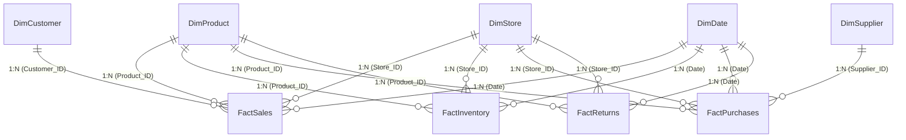

# Power BI Dashboard & Data Model Documentation
## Project: Walmart-Style Supermarket Supply Chain & Inventory Management Analytics

---

## 1. Architectural Architecture & Data Model Structure

The Power BI solution is structured around an enterprise-grade **Star-Schema Data Model** designed to maximize DAX performance, eliminate ambiguous relationship paths, and provide clear analytical granularity across inventory, sales, procurement, and customer returns.



### Table Roles & Relationships

| Source Sheet | Model Role | Table Name | Key Column | Foreign Keys / Target Table | Relationship Cardinality | Cross Filter Direction |
| :--- | :--- | :--- | :--- | :--- | :--- | :--- |
| `Products` | Dimension | `DimProduct` | `Product_ID` | `FactSales`, `FactInventory`, `FactPurchases`, `FactReturns` | 1 to Many (`1:*`) | Single |
| `Stores` | Dimension | `DimStore` | `Store_ID` | `FactSales`, `FactInventory`, `FactPurchases`, `FactReturns` | 1 to Many (`1:*`) | Single |
| `Customers` | Dimension | `DimCustomer` | `Customer_ID` | `FactSales` | 1 to Many (`1:*`) | Single |
| `Suppliers` | Dimension | `DimSupplier` | `Supplier_ID` | `FactPurchases` | 1 to Many (`1:*`) | Single |
| Auto/CALENDAR | Dimension | `DimDate` | `Date` | `FactSales[Order_Date]`, `FactInventory[Inventory_Date]`, `FactPurchases[Order_Date]`, `FactReturns[Return_Date]` | 1 to Many (`1:*`) | Single |
| `Sales_Orders`| Fact | `FactSales` | `Order_ID` | Linked to `DimProduct`, `DimStore`, `DimCustomer`, `DimDate` | Many to 1 (`*:1`) | N/A |
| `Inventory` | Fact | `FactInventory` | `Inventory_ID` | Linked to `DimProduct`, `DimStore`, `DimDate` | Many to 1 (`*:1`) | N/A |
| `Purchases` | Fact | `FactPurchases` | `PO_ID` | Linked to `DimProduct`, `DimStore`, `DimSupplier`, `DimDate` | Many to 1 (`*:1`) | N/A |
| `Returns` | Fact | `FactReturns` | `Return_ID` | Linked to `DimProduct`, `DimStore`, `DimDate` | Many to 1 (`*:1`) | N/A |

---

## 2. Complete DAX Measure Suite

All metrics are grouped into a dedicated DAX Measure Table `[Key_Measures]` for clean governance and maintenance.

### Sales & Financial DAX Measures

```dax
// 1. Total Sales Revenue
Total Sales = 
SUM(FactSales[Sales_Amount])

// 2. Total Cost of Goods Sold (COGS)
Total COGS = 
SUM(FactSales[COGS])

// 3. Gross Profit
Gross Profit = 
[Total Sales] - [Total COGS]

// 4. Profit Margin Percentage
Profit Margin % = 
DIVIDE([Gross Profit], [Total Sales], 0)

// 5. Total Order Count
Total Orders = 
DISTINCTCOUNT(FactSales[Order_ID])

// 6. Total Units Sold
Units Sold = 
SUM(FactSales[Quantity])

// 7. Average Order Value (AOV)
Average Order Value = 
DIVIDE([Total Sales], [Total Orders], 0)

// 8. Average Discount Percentage
Average Discount % = 
AVERAGE(FactSales[Discount_Pct])

// 9. Month-over-Month Sales Growth %
MoM Sales Growth % = 
VAR CurrentMonthSales = [Total Sales]
VAR PreviousMonthSales = CALCULATE([Total Sales], DATEADD(DimDate[Date], -1, MONTH))
RETURN
    DIVIDE(CurrentMonthSales - PreviousMonthSales, PreviousMonthSales, 0)

// 10. Product Revenue Contribution %
Sales Contribution % = 
DIVIDE(
    [Total Sales], 
    CALCULATE([Total Sales], ALL(DimProduct)), 
    0
)
```

### Inventory & Stock Keeping DAX Measures

```dax
// 11. Current Total Inventory Valuation
Inventory Value = 
SUMX(
    FactInventory,
    FactInventory[Stock_On_Hand] * RELATED(DimProduct[Unit_Cost])
)

// 12. Current Stock On Hand Units
Total Stock On Hand = 
SUM(FactInventory[Stock_On_Hand])

// 13. Current Available Stock Units
Total Available Stock = 
SUM(FactInventory[Available_Stock])

// 14. Stockout Product Count (Stock = 0)
Stockout Count = 
CALCULATE(
    COUNTROWS(FactInventory),
    FactInventory[Stock_On_Hand] = 0,
    FactInventory[Inventory_Date] = MAX(FactInventory[Inventory_Date])
)

// 15. Low Stock Count (Stock < Reorder Level)
Low Stock Count = 
CALCULATE(
    COUNTROWS(FactInventory),
    FactInventory[Stock_On_Hand] < RELATED(DimProduct[Reorder_Level]),
    FactInventory[Stock_On_Hand] > 0,
    FactInventory[Inventory_Date] = MAX(FactInventory[Inventory_Date])
)

// 16. Critical Stock Count (Stock < Safety Stock)
Critical Stock Count = 
CALCULATE(
    COUNTROWS(FactInventory),
    FactInventory[Stock_On_Hand] < RELATED(DimProduct[Safety_Stock]),
    FactInventory[Stock_On_Hand] > 0,
    FactInventory[Inventory_Date] = MAX(FactInventory[Inventory_Date])
)

// 17. Overstock Product Count (Stock > 3x Reorder Level)
Overstock Count = 
CALCULATE(
    COUNTROWS(FactInventory),
    FactInventory[Stock_On_Hand] > (3 * RELATED(DimProduct[Reorder_Level])),
    FactInventory[Inventory_Date] = MAX(FactInventory[Inventory_Date])
)

// 18. Inventory Turnover Ratio (Annualized COGS / Avg Inventory Value)
Inventory Turnover = 
VAR AnnualizedCOGS = [Total COGS] * 6  // 60 days scaled to 360 days
VAR AvgInventoryValue = [Inventory Value]
RETURN
    DIVIDE(AnnualizedCOGS, AvgInventoryValue, 0)
```

### Supply Chain & Procurement DAX Measures

```dax
// 19. Total Purchase Order Spend
Total Purchase Cost = 
SUM(FactPurchases[Purchase_Cost])

// 20. Total Purchase Orders Count
Total PO Count = 
COUNTROWS(FactPurchases)

// 21. Average Supplier Lead Time (Days)
Average Lead Time = 
AVERAGE(FactPurchases[Lead_Time_Days])

// 22. On Time Delivery Percentage
On Time Delivery % = 
DIVIDE(
    CALCULATE(COUNTROWS(FactPurchases), FactPurchases[On_Time] = "Yes"),
    COUNTROWS(FactPurchases),
    0
)

// 23. Delayed Purchase Orders Count
Delayed PO Count = 
CALCULATE(
    COUNTROWS(FactPurchases),
    FactPurchases[On_Time] = "No"
)

// 24. Average Delay Duration (Days)
Average Delay Days = 
CALCULATE(
    AVERAGE(FactPurchases[Delay_Days]),
    FactPurchases[Delay_Days] > 0
)
```

### Returns & Quality Control DAX Measures

```dax
// 25. Total Units Returned
Returned Units = 
SUM(FactReturns[Quantity_Returned])

// 26. Total Refund Amount
Total Refund Amount = 
SUM(FactReturns[Refund_Amount])

// 27. Overall Return Rate %
Return Rate % = 
DIVIDE([Returned Units], [Units Sold], 0)

// 28. ABC Product Revenue Classification
ABC Product Class = 
VAR CumSales = 
    SUMX(
        TOPN(
            RANKX(ALL(DimProduct), [Total Sales], , DESC),
            ALL(DimProduct),
            [Total Sales],
            DESC
        ),
        [Total Sales]
    )
VAR TotalCompanySales = CALCULATE([Total Sales], ALL(DimProduct))
VAR CumPct = DIVIDE(CumSales, TotalCompanySales, 0)
RETURN
    SWITCH(
        TRUE(),
        CumPct <= 0.70, "A (Core 70%)",
        CumPct <= 0.90, "B (Medium 20%)",
        "C (Tail 10%)"
    )
```

---

## 3. Power BI Dashboard Pages Specification

### Page 1 — Executive Overview
* **Target Audience**: Chief Retail Officer (CRO), VP of Operations, Store General Managers.
* **Top KPI Cards**: Total Sales Revenue, Gross Profit, Profit Margin %, Inventory Value, Stockout Count, On-Time Delivery %, Overall Return Rate %.
* **Main Visuals**:
  1. *Line & Clustered Column Chart*: Daily Revenue Trend vs. Profit Margin %.
  2. *Treemap*: Sales Revenue Breakdown by Department.
  3. *Bar Chart*: Top 8 Store Locations by Sales & Gross Profit.
  4. *Donut Chart*: Inventory Health Distribution (Healthy, Low Stock, Overstock, Stockout).
  5. *Ranked Table*: Top 10 Revenue-Generating SKUs with Units Sold and Margin %.

### Page 2 — Sales Analytics
* **Target Audience**: Category Managers, Merchandising Team, Sales Directors.
* **Filter Slicers**: Store Region, Department, Customer Segment, Payment Method, Date Horizon.
* **Main Visuals**:
  1. *Area Chart*: Monthly Sales Revenue & Order Volume Growth.
  2. *Waterfall Chart*: Revenue Contribution by Subcategory.
  3. *Matrix Grid*: Store vs. Department Revenue Heatmap with conditional background color formatting.
  4. *Pie Chart*: Transaction Distribution by Payment Method (UPI, Credit Card, Cash, etc.).
  5. *Bar Chart*: Average Order Value (AOV) by Customer Segment.

### Page 3 — Inventory Analytics
* **Target Audience**: Inventory Control Managers, Warehouse Supervisors, Replenishment Analysts.
* **Filter Slicers**: Store Location, Department, Inventory Status (Stockout, Low, Healthy, Overstock).
* **Main Visuals**:
  1. *Gauge Cards*: Current Inventory Value vs. Target Holding Cap; Stockout Count vs Zero-Tolerance Goal.
  2. *Clustered Bar Chart*: Inventory Stock On Hand vs. Reorder Level by Department.
  3. *Scatter Plot*: Stock On Hand vs. Sales Velocity (Identifies Slow-Moving vs. Fast-Moving Items).
  4. *High-Priority Action Table*: Products below Safety Stock requiring immediate PO issuance (Store, Product Name, Available Stock, Safety Stock, Shortfall).

### Page 4 — Supply Chain / Supplier Analytics
* **Target Audience**: Chief Procurement Officer (CPO), Supply Chain Analysts, Vendor Managers.
* **Filter Slicers**: Supplier Name, City/State, Supplier Rating Range, Lead Time Delay Status.
* **Main Visuals**:
  1. *Scatter Plot*: Supplier Rating vs. Average Lead Time Variance (Highlights Unreliable Vendors).
  2. *Stacked Bar Chart*: On-Time vs. Delayed Purchase Orders by Supplier.
  3. *Line Chart*: Monthly Supplier Delay Trend & Average Delay Duration (Days).
  4. *Vendor Scorecard Matrix*: Supplier Name, PO Count, Total Spend, Avg Lead Time, On-Time %, Delay Penalty Score.

### Page 5 — Customer Analytics
* **Target Audience**: Marketing Directors, Customer Loyalty Teams, Business Development.
* **Filter Slicers**: Customer Segment (Regular, Premium, Occasional), Age Group, City.
* **Main Visuals**:
  1. *Clustered Bar Chart*: Total Revenue & Units Purchased by Customer Segment.
  2. *Choropleth Map / Filled Map*: Sales Revenue Distribution by Customer City.
  3. *Donut Chart*: Customer Demographics breakdown by Age Group and Gender.
  4. *Bar Chart*: Preferred Payment Method by Age Group.

### Page 6 — Product Performance & ABC Classification
* **Target Audience**: Product Managers, Procurement Planners, Pricing Analysts.
* **Filter Slicers**: ABC Category (Class A, Class B, Class C), Department, Brand.
* **Main Visuals**:
  1. *Pareto Chart (Line & Bar)*: Cumulative Product Revenue Contribution % (Visualizing 80/20 Rule).
  2. *Scatter Plot*: Unit Selling Price vs. Sales Volume (Price Elasticity Matrix).
  3. *Table*: ABC Product Classification Grid (Product ID, Name, Category, Revenue, Margin %, ABC Status).
  4. *Bar Chart*: Bottom 10 Underperforming SKUs by Gross Profit.

### Page 7 — Returns & Quality Control Analytics
* **Target Audience**: Quality Assurance Managers, Store Managers, Vendor Relations.
* **Filter Slicers**: Return Reason, Store Name, Department, Date Range.
* **Main Visuals**:
  1. *Donut Chart*: Return Reason Distribution (Damaged, Quality Issue, Customer Mind Change, Expired, Wrong Item).
  2. *Bar Chart*: Total Refund Amount by Product Department.
  3. *Line Chart*: Return Rate % Trend over time.
  4. *Detail Grid Table*: Returned Products with Order ID, Customer Segment, Store, Reason, Quantity Returned, and Refunded Value.

---

## 4. Design Aesthetics & Formatting Theme Rules

* **Color Palette**:
  - Primary Base: `#1F4E78` (Navy Blue)
  - Secondary Accent: `#20B2AA` (Teal)
  - Dark Neutral: `#2F5597` (Slate)
  - Visual Alert Color Rules:
    * **Red (`#D9534F`)**: Stockout / Delayed POs / High Return Rate / Critical Deficit
    * **Orange (`#F0AD4E`)**: Low Stock / Below Reorder Level / Moderate Delay
    * **Green (`#5CB85C`)**: Healthy Stock / On-Time Delivery / High Profit Margin
    * **Blue (`#0275D8`)**: Overstocked Items / Premium Segments
* **Typography**: Segoe UI / Din Neutral, clean sans-serif layout with clear hierarchy (Card KPI Title: 12pt, Metric Value: 24pt Bold, Header Title: 14pt Bold).
